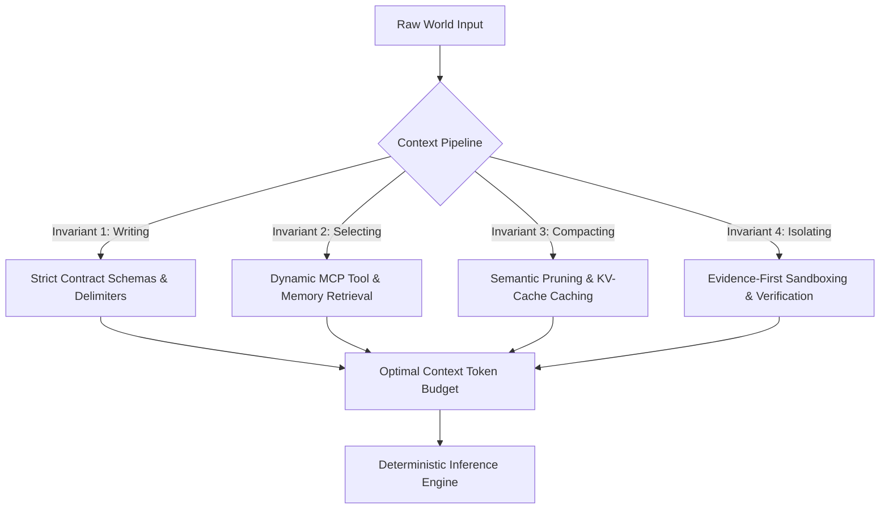

# 📜 The Context Engineering Manifesto (2026)
### From Fragile Prompting to Deterministic Cognitive Memory Architecture

<div align="center">

[](../LICENSE)
[-blueviolet?style=for-the-badge)](https://github.com/kreftamarcio/prompt-engineering-corpus)
[](https://github.com/kreftamarcio/prompt-engineering-corpus)

</div>

---

## 🏛️ Executive Abstract

The artificial intelligence industry has arrived at a structural inflection point. For three years, practitioners treated Large Language Models (LLMs) as natural language text boxes, giving rise to the craft known as "Prompt Engineering"—the trial-and-error manipulation of conversational phrasing, polite preambles, and unconstrained instructions.

**In 2026, Prompt Engineering as an isolated discipline has reached its computational ceiling.**

As models grew from 8K context windows to 1M–2M tokens (Google Gemini 1.5/2.0 Pro) and transitioned into multi-turn autonomous coding agents (Claude Code, Antigravity, SWE-bench systems), naive prompt stuffing broke down. It caused catastrophic memory bloat, KV-cache thrashing, indirect prompt injection vulnerability (OWASP LLM01), and the phenomenon known as *contextual drift*.

The frontier has moved to **Context Engineering**: the systems-level discipline of structuring, partitioning, compressing, and isolating the total working memory (RAM) supplied to an LLM (CPU) across its operational lifecycle.

---

## ⚡ The Fundamental Axiom: LLM as CPU, Context as RAM

Formalized by Andrej Karpathy and proven across frontier research labs:

```
┌────────────────────────────────────────────────────────────────────────┐
│                      THE COGNITIVE COMPUTER ANALOGY                    │
├────────────────────────────────────────────────────────────────────────┤
│ Traditional Computing                   Agentic AI Computing           │
├────────────────────────────────────────────────────────────────────────┤
│ Central Processing Unit (CPU)    <--->  Large Language Model (Weights) │
│ Random Access Memory (RAM)       <--->  Inference Context Window       │
│ Disk Storage / Filesystem        <--->  Vector DB / External Knowledge │
│ Bus & Peripheral Drivers         <--->  Model Context Protocol (MCP)   │
│ OS Memory Manager                <--->  Context Engineer               │
└────────────────────────────────────────────────────────────────────────┘
```

Treating an LLM purely through prompt wording is the equivalent of trying to fix memory fragmentation in an operating system by renaming variables. The core task of the AI Engineer is to act as the **Kernel Memory Manager**, deciding at microsecond resolution:
1. What data enters working memory;
2. What data must be evicted or paged out;
3. How to guarantee immutable memory pages for hardware acceleration (**Prefix Caching**);
4. How to prevent memory space contamination (**Delimiter Isolation**).

---

## 🔬 The 4 Invariants of Context Engineering

Every autonomous system in the Q1 Matrix conforms to the **4 Context Invariants**:



### 1. Invariant 1: Writing (Spec-Driven Precision)
Natural language prose is probabilistic and high-entropy. Context Engineers write declarative contracts using typed interfaces (JSON Schema, Pydantic, Zod) and hardened semantic tags (`<system_ontology>`, `<context_contract>`, `<execution_protocol>`).

### 2. Invariant 2: Selecting (Dynamic Working Set)
Never dump entire codebases or databases into the model window. The working set must be retrieved on-demand via the **Model Context Protocol (MCP)**, loading only the AST nodes, commit ranges, or API schemas pertinent to the immediate turn.

### 3. Invariant 3: Compacting (Prefix Stability & Token Economy)
To exploit hardware-accelerated prompt caching in Google Gemini and Anthropic Claude, the first $N$ tokens of the system context must remain bit-for-bit immutable across turns. Dynamic tokens are appended strictly at the tail, reducing latency by up to 80% and cost by up to 70%.

### 4. Invariant 4: Isolating (Evidence-First Security)
External user inputs and raw web crawls are classified as **Untrusted Data Payloads**. They are quarantined behind delimiter barriers. The system enforces the **Verification Before Completion** standard: no task transition is accepted without an automated test output or compiler proof.

---

## 🏆 The New Global Benchmark Standard

The Q1 Corpus commits to the following quantitative targets:
* **Token Economy Ratio:** > 40% reduction in token density vs raw human-written instructions.
* **KV-Cache Hit Ratio:** > 85% cache hit on multi-turn interactions.
* **Deterministic Accuracy:** > 99.2% schema adherence across batch evals.
* **Zero Epistemic Drift:** 100% of task completions validated by automated test execution.

---

<div align="center">
  <sub>Authored by <b>Márcio Krefta</b> & the <b>Q1 by TACO</b> Research Collective • October 2026</sub>
</div>
